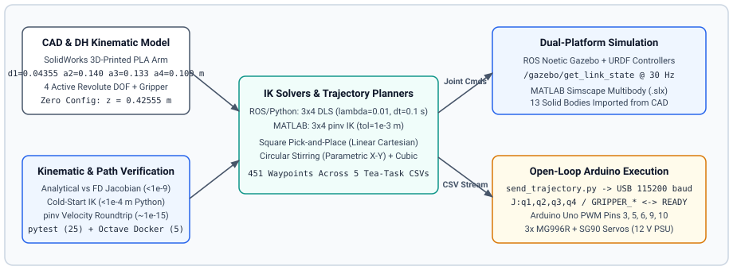

# 4-DOF Service Robotic Manipulator

[](LICENSE)
[](https://github.com/andrew-abdelmalak/4-dof-service-manipulator/actions/workflows/ci.yml)
[](pyproject.toml)
[](simulation/ros/src/my_robot_gazebo/README.md)
[](hardware/arduino/README.md)

We designed, modeled, simulated, and built a desktop-scale **4-DOF service robotic manipulator** that automates a five-phase tea-preparation sequence (picking up and placing a sugar cube, carrying a spoon, centering inside a cup, and stirring). The repository brings together SolidWorks CAD files, Proteus schematics, Denavit-Hartenberg (DH) kinematics and trajectory planners in Python/ROS Noetic and MATLAB/Octave, a Simscape Multibody model, and Arduino Uno servo firmware.

<p align="center">
  
</p>

> Full IEEE-format technical report: [`docs/4DOF_Service_Manipulator.pdf`](docs/4DOF_Service_Manipulator.pdf).

## System Architecture

<p align="center">
  
</p>

| Subsystem | Hardware or Software Stack | Role |
|---|---|---|
| Structure & CAD | 3D-printed PLA, SolidWorks (`.SLDASM`, `.STEP`) | Desktop 4-DOF arm and gripper mechanism |
| Electronics & Actuation | Arduino Uno, 3x MG996R, 3x SG90 (one fixed pivot), 12 V DC PSU | Open-loop PWM joint actuation and Proteus schematic (`hardware/actuator_connections.pdsprj`) |
| ROS / Gazebo Simulation | ROS Noetic, `my_robot_gazebo`, URDF, `/gazebo/get_link_state` at 30 Hz | Physics simulation, damped least-squares IK, trajectory execution |
| MATLAB / Octave & Simscape | MATLAB R2023b+ / GNU Octave 9.2.0, Simscape `.slx` (13 rigid bodies) | Symbolic/numeric kinematics, `pinv` IK, multibody simulation |
| Host Serial Sender | `hardware/arduino/send_trajectory.py` (`pyserial` at 115200 baud) | Streams 451 CSV waypoints with `READY` handshake |

<p align="center">
  
  &nbsp;&nbsp;
  
</p>

## DH Parameters & Kinematics

We use standard Denavit-Hartenberg transforms derived from the SolidWorks link dimensions ($d_1 = 0.04355\text{ m}$, $a_2 = 0.140\text{ m}$, $a_3 = 0.133\text{ m}$, $a_4 = 0.109\text{ m}$).

<p align="center">
  
</p>

| Link | $\theta_i$ | $d_i$ (m) | $a_i$ (m) | $\alpha_i$ (rad) |
|---:|---|---:|---:|---:|
| 1 | $q_1$ | 0.04355 | 0 | $\pi/2$ |
| 2 | $q_2 + \pi/2$ | 0 | 0.140 | $\pi$ |
| 3 | $q_3$ | 0 | 0.133 | $\pi$ |
| 4 | $q_4$ | 0 | 0.109 | 0 |

At the zero configuration $q = [0, 0, 0, 0]^T$, the end-effector sits at $[0, 0, 0.42555]^T\text{ m}$. Position IK uses the analytical $3 \times 4$ linear Jacobian $J_v(\mathbf{q})$ with Newton-Raphson updates:

- **ROS/Python (`kinematics.py`):** Damped Least-Squares ($\lambda = 0.01$, position tolerance $10^{-4}\text{ m}$, max 500 iterations, joint limits $[-1.57, 1.57]\text{ rad}$, segment duration $3.0\text{ s}$).
- **MATLAB/Octave (`inverse_kinematics_func.m`):** Undamped Moore-Penrose pseudoinverse (`pinv`, position tolerance $10^{-3}\text{ m}$, max 100 iterations, segment duration $2.0\text{ s}$).

## Validation Scope & Verified Results

We separate what was physically demonstrated in the university lab from what is reproducible today without physical hardware or proprietary licenses.

- **Physical hardware (original lab run):** We executed open-loop single-joint range checks (`receiver.ino` + MG996R/SG90 arm) and the full five-phase tea-preparation trajectory (451 unique waypoints, 3 stirring cycles) as documented in [`docs/4DOF_Service_Manipulator.pdf`](docs/4DOF_Service_Manipulator.pdf). The physical rig uses open-loop PWM without encoders, so square corners experience gear backlash and gravity deflection under load.
- **Full 3D physics & multibody (requires desktop tools):** ROS Noetic Gazebo simulation (`spawn_gazebo.launch`) and MATLAB Simscape Multibody (`x5_DOF_Robot_Assembly.slx`) were run on workstation setups to produce the simulation traces in `docs/figures/`.
- **Offline & CI checks (reproducible on every clone/PR):** Our GitHub Actions workflow runs Python unit/kinematics tests (`pytest`), Ruff checks, standalone roundtrip validation (`validate_roundtrip.py`), CSV dry-run streaming (`send_trajectory.py --dry-run`), headless GNU Octave verification in Docker, and `arduino-cli` firmware compilation for `arduino:avr:uno`.

| Check | Python (`validate_roundtrip.py`) | GNU Octave 9.2.0 (`simulation/matlab/tests/`) |
|---|---|---|
| Zero-config FK height | $0.425550\text{ m}$ (0 error) | $0.425550\text{ m}$ (`0.0000e+00` m error) |
| Analytical vs FD linear Jacobian | $\le 5.86 \times 10^{-10}$ (20 configs `< 1e-8` in pytest) | `6.2143e-11` max diff (`create_jacobian_func.m`) |
| Cold-start position IK ($q_0 = \mathbf{0}$) | $0$, $5.66 \times 10^{-5}$, $5.45 \times 10^{-5}\text{ m}$ | $0$, $4.96 \times 10^{-4}\text{ m}$ (`test_inverse_kinematics.m`) |
| Warm-start joint recovery | $\le 1.39 \times 10^{-17}\text{ rad}$ | `0.0000e+00` rad (`test_velocity_kinematics.m`) |
| Velocity roundtrip (`pinv`, $\lambda=0$) | $0$, $9.42 \times 10^{-16}$, $1.18 \times 10^{-15}\text{ rad/s}$ ($\le 1.20 \times 10^{-15}$) | $1.21 \times 10^{-17}$ to $2.20 \times 10^{-15}\text{ rad/s}$ |
| Velocity roundtrip (DLS, $\lambda=0.01$) | $1.00 \times 10^{-5}$, $5.00 \times 10^{-3}$, $8.42 \times 10^{-3}\text{ rad/s}$ | Uses `pinv` |

<p align="center">
  
  &nbsp;&nbsp;
  
</p>

## Quick Start (Offline Checks Without Hardware)

Clone the repository, install the locked Python environment with `uv`, and run the Python, Octave, and Arduino verification checks.

```bash
git clone https://github.com/andrew-abdelmalak/4-dof-service-manipulator.git
cd 4-dof-service-manipulator

# 1. Python tests, lint, roundtrip check, and CSV dry run
uv sync --locked
uv run ruff check .
uv run pytest -v
uv run python simulation/ros/src/my_robot_gazebo/scripts/validate_roundtrip.py
uv run python hardware/arduino/send_trajectory.py --dry-run

# 2. MATLAB/Octave test scripts in GNU Octave Docker container
docker run --rm -v "$PWD:/workspace" -w /workspace \
  gnuoctave/octave:9.2.0 \
  octave --no-gui --quiet --eval "
    set(0, 'defaultfigurevisible', 'off');
    run('simulation/matlab/tests/test_forward_position.m');
    run('simulation/matlab/tests/test_inverse_kinematics.m');
    run('simulation/matlab/tests/test_velocity_kinematics.m');
    run('simulation/matlab/tests/run_fk_4dof.m');
    run('simulation/matlab/kinematics/create_jacobian_func.m');
  "

# 3. Compile Arduino Uno firmware (requires arduino-cli + arduino:avr + Servo)
arduino-cli compile --warnings all --fqbn arduino:avr:uno hardware/arduino/receiver/receiver.ino
```

### ROS Noetic Gazebo & Hardware Execution

- **ROS Noetic:** Link `simulation/ros/src/my_robot_gazebo` into your `catkin_ws/src/`, build with `catkin_make`, launch `roslaunch my_robot_gazebo spawn_gazebo.launch`, and run `rosrun my_robot_gazebo trajectory_node.py`. See [`simulation/ros/src/my_robot_gazebo/README.md`](simulation/ros/src/my_robot_gazebo/README.md).
- **Arduino hardware:** Upload `hardware/arduino/receiver/receiver.ino` and run `uv run python hardware/arduino/send_trajectory.py --port /dev/ttyACM0`. See [`hardware/arduino/README.md`](hardware/arduino/README.md).

## Repository Layout

```text
4-dof-service-manipulator/
├── .github/                  # CI workflow, Dependabot config, issue and PR templates
├── docs/                     # Technical paper (.tex/.pdf), figures, architecture & social preview assets
├── hardware/
│   ├── actuator_connections.pdsprj  # Proteus schematic
│   ├── arduino/              # receiver.ino firmware, send_trajectory.py CLI, 5 trajectory CSVs
│   └── cad/                  # SolidWorks .SLDASM assembly and 14 .STEP part files
├── simulation/
│   ├── matlab/               # Kinematics, trajectory planners, Octave/MATLAB tests, Simscape .slx
│   └── ros/src/my_robot_gazebo/  # URDF, controllers, launch file, ROS nodes and offline kinematics
├── tests/                    # 25 pytest checks covering kinematics, trajectories, and CSV integrity
├── pyproject.toml            # Pinned Python configuration, Ruff rules, pytest settings
└── uv.lock                   # Locked dependency graph (with 14-day release cooldown)
```

## Authors & Acknowledgments

Developed by our Mechatronics Engineering team at the German University in Cairo (GUC):

| Name | Affiliation |
|---|---|
| Andrew Abdelmalak | Mechatronics Engineering, GUC |
| Daniel Boules | Mechatronics Engineering, GUC |
| David Girgis | Mechatronics Engineering, GUC |
| Kirolous Kirolous | Mechatronics Engineering, GUC |
| Samir Yacoub | Mechatronics Engineering, GUC |
| Youssef Salama | Mechatronics Engineering, GUC |

## References

1. S. Park *et al.*, "Robot versus human barista: Comparison of volatile compounds and consumers' acceptance, sensory profile, and emotional response of brewed coffee," *Food Research International*, vol. 172, p. 113119, 2023.
2. A. Setiawan and A. Ma'arif, "Stirring system design for automatic coffee maker using OMRON PLC and PID control," *Int. J. Robotics and Control Systems*, vol. 1, no. 3, pp. 390-401, 2021.
3. S. Michalkova, K. Wojnarowsky, S. Kolenyak, M. Kantor, and J. Arm, "Automating the handling process of a coffee machine using a robotic manipulator," in *Proc. XV Int. Symp. Industrial Electronics and Applications (INDEL)*, 2024, pp. 1-5.
4. H. P. Nurba, D. Hadian, N. Lestari, K. A. Munastha, H. Mistialustina, and E. Rachmawati, "Performance evaluation of 3 DOF arm robot with forward kinematics Denavit-Hartenberg method for coffee maker machine," in *Proc. IEEE Int. Conf. Telecommunication Systems, Services, and Applications (TSSA)*, 2022, pp. 1-6.
5. H. D. Salman, M. N. Hamzah, and S. H. Bakhy, "Kinematics analysis and implementation of three degrees of freedom robotic arm by using MATLAB," *The Iraqi Journal for Mechanical and Materials Engineering*, vol. 21, no. 2, pp. 118-129, 2021.
6. A. Waluyo, A. Tafrikhatin, and S. R. Heri, "Robot arm design for coffee maker Arduino based," in *Proc. 2nd Borobudur Int. Symposium on Science and Technology (BIS-STE 2020)*, Atlantis Press, 2021, pp. 438-442.
7. J. J. Craig, *Introduction to Robotics: Mechanics and Control*, 3rd ed. Pearson Prentice Hall, 2005.
8. B. Siciliano, L. Sciavicco, L. Villani, and G. Oriolo, *Robotics: Modelling, Planning and Control*. Springer, 2009.

## License

MIT. See [LICENSE](LICENSE).
